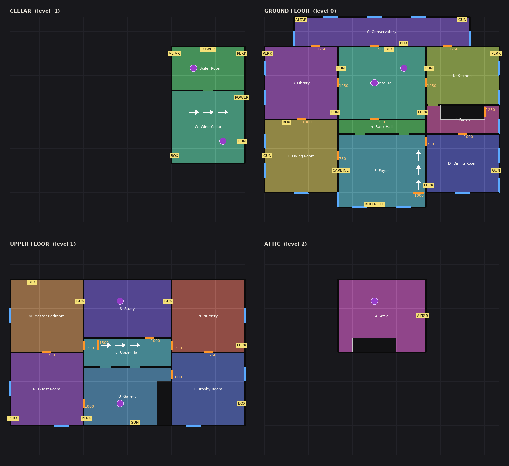

# Last Light: Endless reference place (3 Nov 2026)

The owner asked for an Endless mode built on its own as reference code, so that Endless can then be
built into the zombie mode from it. The brief was the Mortuus video (BaronVonGames, "This game is
like Roguelike COD Zombies But BETTER", https://youtu.be/tDO-QSw2YrY), with a weapon randomizer, in
a huge house. "On a space" was dropped by the owner ("forget that"), so the house is an ordinary
night-time manor.

This is a standalone place: `endless.project.json`, scripts in `src/endless/`, port 34874. It shares
nothing with `src/common`, so it cannot break the lobby or the campaign. Everything it needs is built
by its own scripts: the house, the zombies and the guns are plain parts, so it runs in an empty place.

**Nothing here has been playtested.** It was written in a cloud session with no Studio. It passed a
layout checker, a rough syntax and name checker and three code reviews. That is not the same as a
run in Studio.

## Trying it

1. Make a new place in the Last Light universe. You can do this in Creator Hub, or in Studio with File > New (Baseplate), then File > Publish to Roblox As, choosing the Last Light game.
2. Copy two things from the lobby place into the new place. These are optional, but the place is bare without them:
   - `StarterGui.HUD`, the authored HUD. Without it there is no round counter, points or ammo on screen.
   - `ReplicatedStorage.Assets.Sounds`, the zombie mode's sounds. Without it the place is silent.
3. Run `rojo serve endless.project.json` and connect the Rojo plugin on port 34874.
4. Optionally set `Lighting.Technology` to Future so the room lamps throw shadows. Scripts cannot set this.
5. Consider turning off `Workspace.StreamingEnabled`, which new places have on. With it on, spawning waits for the house to stream in around each player, and clients only see zombies near them. That works, but this place is small enough not to need streaming.
6. Press Play. The server deletes the template's Baseplate and SpawnLocation and builds the house.

Studio-only test switches are workspace attributes, read when a run starts:

| Attribute | Type | Effect |
|---|---|---|
| `EndlessStartRound` | number | Start at that round. |
| `EndlessStartPoints` | number | Everyone starts with that many points. |
| `EndlessPower` | bool | The power is on from the start. |
| `EndlessGod` | bool | Nothing can hurt players. |
| `EndlessOpenAll` | bool | Every door starts open. |

## How a run plays

The loop is Call of Duty Zombies' rounds with Mortuus' roguelike layer. Every number is in
`ReplicatedStorage.Endless.Config`.

1. **Start.** Everyone spawns in the foyer with the Service Pistol and 500 points. Round 1 starts 15 seconds later.
2. **Rounds.** These use Call of Duty's numbers:
   - Zombie count: 6, 8, 13, 18 and 24 for the first five rounds played alone, then more each round and more with more players.
   - Zombie health: 150, up by 100 a round until round 9, then 10% more every round.
   - At most 24 zombies are up at once.
   - Zombies rise out of the yard outside a boarded window, tear the boards off one by one and climb in. For upper-floor windows they climb the wall first. Some rooms also have broken floor hatches they claw up through.
   - Only rooms the squad has opened send zombies.
   - From round 4 a growing share of them run.
   - From round 8 Brutes come: big, slow, tough, and worth 300 points.
   - From round 12 some come in already crawling on their arms.
   - Any zombie can lose its arms and legs to gunfire. Heads never tear. Blood is green.
3. **Points** follow Call of Duty: 10 a hit, 50 a kill, 100 for a headshot kill, 130 for a knife kill, and 10 for every board nailed back up.
4. **Spending.**
   - **Doors and stair gates** cost 750 to 1500. Each price moves by up to 250 every run.
   - **Guns on the walls** are drawn in chalk. Buying the gun again buys its ammo.
   - **The weapon randomizer** is the mystery box. It costs 950. Guns flick past for four seconds, then it settles on one you don't carry and holds it for 12 seconds. After four spins at one spot, any spin may turn up a skull instead: you get your points back and the box moves to another spot.
   - **Perk machines** need the power switch in the cellar turned on first. There are five:
     - Bulwark Brew: 250 health.
     - Quickhand Tonic: reload twice as fast.
     - Twin Fang Tonic: fire a third faster.
     - Lazarus Draught: faster revives, or a self-revive when playing alone.
     - Packmule Tonic: carry a third gun.
     - You can hold at most four perks, and you lose them all when you go down.
   - **The gun ascension altar** also needs power. This is Mortuus' altar and Call of Duty's Pack-a-Punch. Hold the gun you want to ascend and pay; the price grows each time. The altar takes the gun and three boosts rise around it for you alone. Take one and the gun comes back with that boost, full ammo and a brighter tint, up to eight times. The boosts are damage, magazine, reserve, fire rate, reload, pierce and headshot.
5. **Relics** are Mortuus' draft after every round. Three candles on glowing rings stand in the room most of the squad is in, and everyone may take one before the next round. They stack and last the run. The pool has eleven: the lobby Endless seven, plus Deep Pockets, Quick Hands, Fleet and Bloodthirst.
6. **Power-ups.** Kills sometimes drop one, at most four a round:
   - RESUPPLY: full reserves.
   - REAPER: 30 seconds of one-hit kills.
   - DOUBLE PAY: 30 seconds of double points.
   - PURGE: every zombie up dies, and 400 points each.
   - HAMMER AND NAILS: every board back up, and 200 points each.
7. **Going down.** At no health you go down instead of dying. You crawl, can't shoot, and lose your perks and 5% of your points. A teammate holds Revive on you to get you up. After 30 seconds you die and come back at the next round's end with the pistol.
8. **The end.** When nobody is standing, the run is over. The end screen shows the round reached for 12 seconds. Then the house is rebuilt, with every spot drawn again, and a new run starts.

**Learn the game, not the house** (Mortuus' "new map every run", our way). Every run draws these again:

- where the randomizer starts;
- which perk machine stands on which perk spot;
- the guns on the walls (two fixed in the foyer);
- where the altar and the power switch are;
- every door price;
- the furniture.

## The house: Blackwood Manor

`ServerStorage.Endless.HouseLayout` is the map as ASCII plans: one character per 10-stud cell, four
levels, 19 rooms in 15 zones. HouseBuilder turns it into parts every run:

- walls wherever two rooms meet;
- doors, arches, windows and floor hatches cut where the layout says;
- stairs as ramps with the cells above left open;
- a walled yard of dead trees and graves where zombies rise.

Change the house by editing the plans. Then run `python tools/endless_house.py`. It checks the rules the
builder relies on: rooms in one piece, every room reachable from the foyer, windows on outside walls
with open ground under upper ones, and spots against solid walls. It also redraws
`docs/endless/house.png`.

- **Cellar:** wine cellar and boiler room (the power switch, an altar spot).
- **Ground floor:**
  - The foyer is the start room, with the grand stair (gate 1000).
  - It joins the back hall through arches.
  - From there the house opens into the living room, library, dining room, kitchen and pantry (with the cellar stair), the great hall and the glass conservatory.
- **Upper floor:** the gallery, upper hall, guest room, master bedroom, study, nursery and trophy room.
- **Attic:** reached by its own stair (gate 1500), with an altar spot.

## Code map

All scripts are in `src/endless/`. Each module's header says what it does.

| Script | What it does |
|---|---|
| `ServerScriptService.EndlessServer` | Boot (lighting, collision groups, remotes), the run loop, and the wiring between systems. |
| `ServerStorage.Endless.HouseLayout`, `HouseBuilder` | The map as data, and the part builder. Returns the House: rooms, zones, doors, windows, hatches and spots. |
| `Director` | Rounds: count, health, spawn gaps, runners and Brutes, picking the window or hatch, intermissions. |
| `Horde` | Zombies: the R6 rig from blocks, rising, windows (with `Windows`), hunting, the swipe, limbs, ragdoll. |
| `Survivors` | Player lives: spawning, regen, going down, revives, bleed-out, self-revive. |
| `Arsenal` (+ `Shared Weapons`, `GunModel`) | Guns as Tools, slots, ammo, server checks on shots, the knife. |
| `Economy` | Points with Double Pay and Scavenger, and run stats. |
| `Doors`, `Randomizer`, `WallBuys`, `Perks` (+ power), `Altar` | Everything points are spent on. |
| `Choices`, `Relics`, `PowerUps` | The floor draft (relics and altar boosts) and the drops. |
| `StarterPlayerScripts.EndlessClient` | First-person shooting, input on PC, gamepad and touch, recoil, aim assist. |
| `EndlessHud` | Drives the authored lobby HUD by name. It builds no UI. |
| `EndlessFx` | Zombie poses, blood, drop animation, lamp flicker, per-player prompt wording, spectating. |

## Owner rules, as built

- **Mob blood is green.** Drops on every hit and a burst when a limb tears. Limb tearing stays; heads never tear.
- **No damage numbers** anywhere.
- **Aim assist** on touch and gamepad only, chosen by `UserInputService.PreferredInput`. PC gets none.
- **No script-built screens.** The HUD is the lobby's authored HUD driven by name. Everything else uses world parts and ProximityPrompts. The touch buttons are ContextActionService's own buttons, as a stand-in for the zombie mode's TouchControls.
- **No DataStores at all.** The best round is a workspace attribute for the session. `endRun` in EndlessServer marks where the port saves it.
- **Core loops from proven hits.** Call of Duty Zombies' rounds, points, doors, wall guns, box, perks, power, Pack-a-Punch and drops, plus Mortuus' draft and altar.

Decisions made without the owner, worth a look:

- **Doors are bought with points (Call of Duty).** On 2 Nov the owner made the Defend house's debris shoot-down instead. That rule was not carried over here.
- **The weapon randomizer is the mystery box.** I read "weapon randomizer" that way. It does not hand out a new random gun every round.

## Porting to the zombie mode

The reference keeps its own simple guns, zombies and health so it can run alone. The zombie mode
already has much better versions of those. Port the mode, not the kit.

| Reference | Zombie mode equivalent | What to do |
|---|---|---|
| `Director` | MatchServer's wave loop (Endless branch) | Take the Call of Duty count, health and spawn-gap formulas if wanted, plus entry picking by open zone. |
| `Horde`, `Windows` | MobAI, MobAttack, WindowEntry, MobReactions, Barricades | Keep the zombie mode's own. Only the zone rule ("only opened rooms send zombies") and the Brute/crawler specials are new. |
| `Survivors` | PlayerHealth (down, revive, self-revives) | Keep PlayerHealth. Add the Lazarus solo self-revive and "perks lost when down". |
| `Arsenal`, `EndlessClient` | GunServer, GunClient, Inventory | Keep the real guns. The pieces to add are Give, Fill, Find and Held, the `Boosts` tool attribute (ascension), and `Shared.Weapons` stat sums. |
| `Economy` | Points | Add the Double Pay and Scavenger multipliers. |
| `Doors` | MatchServer debris | Choose bought doors or shoot-down debris (see above). |
| `Randomizer` | MatchServer's MysteryCrate | Replace it, or add the move and skull rule. |
| `WallBuys`, `Perks` + power, `Altar`, `Choices`, `Relics`, `PowerUps` | (new; Relics extends Modules.Relics) | Port as they are. They only need the House shape (spots and zones) and the four calls above. |
| `HouseLayout`, `HouseBuilder` | An authored map | Either keep the builder, or author a huge house in Studio. An authored house would carry the same spots as tagged parts (Box, Perk, Wall, Altar, Power), rooms and zones, and windows with Inside, Outside and Spawn points. |
| `EndlessHud` | MatchHud | Already uses MatchHud's element names. Fold the round and timer text into MatchHud. |

## Not done

- **Not playtested.** It has never been played in Studio.
- **Missing art.** There are no perk icons, Double Pay or Reaper timers beyond the HUD's one line, relic list or box jingle. Those need authored PNG art and sounds.
- **Basic gun feel.** There is no viewmodel or sights. The gun is a Roblox Tool held in first person, so aiming is a zoom.
- **Missing enemies.** There is no ceiling crawler (Mortuus' Skitter), no hound rounds and no hidden boss.
- **Plain house.** The house is plain parts with simple furniture. A real map would replace it.
- **The crawl is a pose, not a smaller body.** Crawlers are laid flat by the RootJoint's Transform, set on the server (so the hitboxes lie where they're seen) and on each client. The Humanoid's own height doesn't change, so the crawler still moves like a standing zombie. The zombie mode's crawl, through HipHeight on R15, is the one to keep.
- **Lazarus Draught's faster revive** works by shortening the Revive hold on the reviver's own client. Roblox times prompt holds on the client, so the server does not check it.
